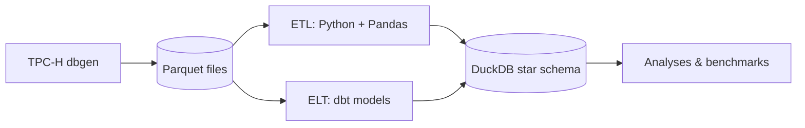

---
# ─────────────────────────────────────────────────────────────────────────
# This is a DRAFT: files in _drafts/ are never published.
# To publish: fill in the TODOs, then move this file to _posts/ and rename it
#   _posts/YYYY-MM-DD-etl-vs-elt-pandas-vs-dbt.md
# ─────────────────────────────────────────────────────────────────────────
title: "ETL vs ELT: benchmarking Pandas against dbt on TPC-H"
description: "I built the same star schema twice — once with Python and Pandas, once with dbt — and measured speed, memory, testability and complexity."
tags: [data engineering, dbt, duckdb, benchmark]
ref: etl-vs-elt     # same ref as the French version → the language switch links them
mermaid: true      # enables ```mermaid diagrams
math: false        # set to true to enable $LaTeX$ formulas
# image: /assets/img/posts/etl-vs-elt-cover.png   # optional cover image
---

**TODO — intro (2–3 sentences).** Why compare ETL and ELT? What question did
you want answered?

## The setup

Both pipelines read the same TPC-H data (generated as Parquet) and build the
same dimensional model on DuckDB:



| Model          | Grain                 |
|----------------|-----------------------|
| `fact_sales`   | one row per line item |
| `dim_customer` | one row per customer  |
| `dim_product`  | one row per part      |
| `dim_region`   | one row per region    |
| `dim_date`     | one row per day       |

A dbt model is just a `SELECT`:

<!-- Writing tip: code containing double curly braces (dbt/Jinja) must be wrapped in
     raw / endraw Liquid tags, as below, or Jekyll will try to evaluate it. -->


```sql
-- models/marts/dim_region.sql
SELECT DISTINCT r_regionkey AS region_key, r_name AS region_name
FROM {{ source('tpch_database', 'region') }}
```


The Pandas equivalent is a function:

```python
def transform_dim_region(region: pd.DataFrame) -> pd.DataFrame:
    return (
        region[["r_regionkey", "r_name"]]
        .drop_duplicates()
        .rename(columns={"r_regionkey": "region_key", "r_name": "region_name"})
        .reset_index(drop=True)
    )
```

## Results

**TODO — paste your benchmark numbers / charts here.**
Put images in `assets/img/posts/` and reference them like this:

<!--  -->

> **TODO — key takeaway.** One sentence a recruiter will remember.

## What I learned

- TODO
- TODO

The full code is on GitHub: [aymanchafni/etl_vs_dbt](https://github.com/aymanchafni/etl_vs_dbt).
