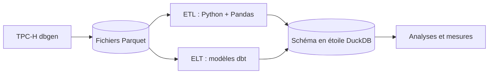

---
# ─────────────────────────────────────────────────────────────────────────
# BROUILLON : les fichiers de fr/_drafts/ ne sont jamais publiés.
# Pour publier : compléter les TODO, puis déplacer ce fichier dans fr/_posts/
# et le renommer  fr/_posts/AAAA-MM-JJ-etl-vs-elt-pandas-contre-dbt.md
# ─────────────────────────────────────────────────────────────────────────
title: "ETL vs ELT : Pandas contre dbt sur TPC-H"
description: "J'ai construit le même schéma en étoile deux fois — avec Python et Pandas, puis avec dbt — et j'ai mesuré vitesse, mémoire, testabilité et complexité."
tags: [ingénierie des données, dbt, duckdb, benchmark]
ref: etl-vs-elt    # même ref que la version anglaise → le sélecteur de langue les relie
mermaid: true
---

**TODO — introduction (2–3 phrases).** Pourquoi comparer ETL et ELT? À quelle
question vouliez-vous répondre?

## Le montage

Les deux pipelines lisent les mêmes données TPC-H (générées en Parquet) et
construisent le même modèle dimensionnel sur DuckDB :



Un modèle dbt n'est qu'un `SELECT` :


```sql
-- models/marts/dim_region.sql
SELECT DISTINCT r_regionkey AS region_key, r_name AS region_name
FROM {{ source('tpch_database', 'region') }}
```


## Résultats

**TODO — vos chiffres et graphiques.**

## Ce que j'en retiens

- TODO

Le code complet est sur GitHub : [aymanchafni/etl_vs_dbt](https://github.com/aymanchafni/etl_vs_dbt).
